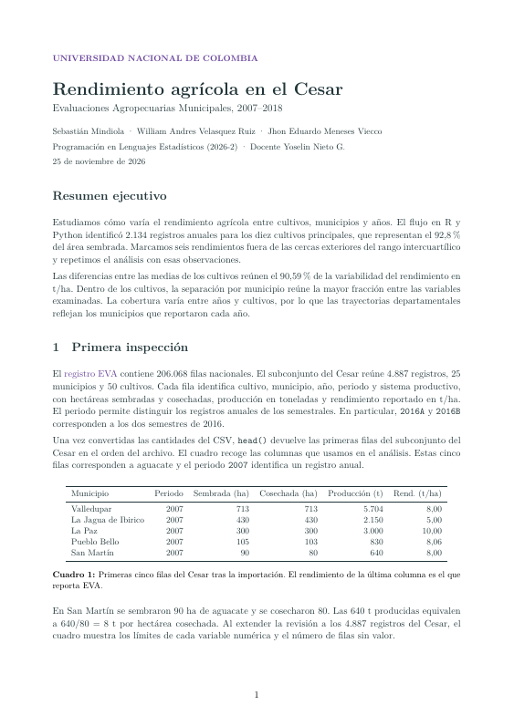

# Rendimiento agrícola en el Cesar

**[Abrir el informe final en PDF](documentos/Informe_final_EVA_Cesar.pdf)** · [Presentación UNAL](documentos/presentacion/presentacion_eva_cesar.pdf) · [Diccionario de datos](documentos/Diccionario_EVA_Cesar.docx)

[](documentos/Informe_final_EVA_Cesar.pdf)

Sebastián Mindiola · William Andres Velasquez Ruiz · Jhon Eduardo Meneses Viecco

Programación en Lenguajes Estadísticos (2026-2) · Universidad Nacional de Colombia

## Qué estudia el proyecto

Describimos cómo varía el rendimiento agrícola en el Cesar entre cultivos, municipios y años. Partimos de 4.887 registros de Evaluaciones Agropecuarias Municipales (EVA). Para cada municipio, cultivo y año, sumamos la producción y el área cosechada, y dividimos las dos sumas para obtener el rendimiento en toneladas por hectárea. El análisis anual abarca 2007–2018.

Las diferencias entre las medias de los cultivos reúnen el **90,59 %** de la variabilidad observada del rendimiento en t/ha. Al incluir los seis extremos identificados con las cercas de 3 IQR, la proporción es **89,97 %**. Dentro de los cultivos, las diferencias entre municipios reúnen la mayor fracción entre las variables comparadas. Estos porcentajes describen la base observada.

## Organización

| Carpeta | Contenido |
|---|---|
| [datos/datos_crudos](datos/datos_crudos/) | CSV original de EVA. |
| [datos/datos_limpios](datos/datos_limpios/) | Subconjuntos y tablas anuales que producen R y Python. |
| [scripts_R](scripts_R/) | Diagnóstico, limpieza, agregación anual y resultados descriptivos. |
| [notebooks_Python](notebooks_Python/) | Las mismas tres etapas para Jupyter o Colab. |
| [documentos](documentos/) | Informe, diccionario, tablas de resultados y figuras. |
| [documentos/presentacion](documentos/presentacion/) | Presentación, fuente Beamer y recursos del tema Oxygen de la UNAL. |

El CSV proviene del [registro público de Evaluaciones Agropecuarias Municipales](https://www.datos.gov.co/d/2pnw-mmge). Los programas incluyen el diagnóstico de 2006. El análisis anual comienza en 2007 porque el subconjunto del Cesar solo tiene el semestre B de 2006.

## Reproducir el análisis

Ejecuta los comandos desde la raíz del repositorio. El CSV de entrada ya está en su carpeta. Cada lenguaje lee el archivo original y utiliza sus propias tablas intermedias.

### R

Se puede ejecutar con R base. Si están disponibles `dplyr` y `ggplot2`, el flujo usa sus funciones para la agregación y las figuras.

```sh
Rscript scripts_R/01_diagnostico_inicial.R
Rscript scripts_R/02_limpieza_transformacion_eda.R
Rscript scripts_R/03_asociaciones_visualizacion.R
```

### Python

Usa Python 3.11 o posterior. Instala las dependencias en un entorno virtual y ejecuta los cuadernos en orden.

```sh
python -m venv .venv
. .venv/bin/activate
python -m pip install -r requirements.txt
python -m ipykernel install --sys-prefix --name eva-cesar

for cuaderno in notebooks_Python/0*.ipynb; do
  jupyter nbconvert --to notebook --execute "$cuaderno" --output-dir .ejecutados \
    --ExecutePreprocessor.kernel_name=eva-cesar --ExecutePreprocessor.timeout=180 || break
done
```

En Jupyter se pueden abrir y ejecutar los tres cuadernos en el mismo orden. En Colab, indica la carpeta del proyecto con `EVA_RAIZ` o colócala en una de las rutas de Drive descritas en las celdas iniciales. Los cuadernos escriben tablas en `datos/datos_limpios/` y `documentos/`, figuras en `documentos/figuras/` y un gráfico local de series que genera la etapa 03.

Comprueba el resultado comparando `e3_R_variabilidad.csv` con `e3_Python_variabilidad.csv`. Las tablas reportan la fracción de suma de cuadrados entre grupos en t/ha y en escala logarítmica. Los archivos `e2_*_atipicos_anuales.csv` identifican los seis registros marcados, y `e2_*_atipicos_origen.csv` conserva las filas que los componen.

## Compilar el informe y la presentación

Con Tectonic instalado, puedes compilar los dos documentos desde la raíz del repositorio.

```sh
(cd documentos/informe_fuente && tectonic informe_final.tex)
(cd documentos/presentacion && tectonic presentacion_eva_cesar.tex)
```

Cada fuente usa las figuras de `documentos/figuras/`. La primera orden genera `documentos/informe_fuente/informe_final.pdf`. Para actualizar el PDF visible en el README, cópialo a `documentos/Informe_final_EVA_Cesar.pdf`. También se puede compilar con XeLaTeX en una distribución que incluya Babel en español.
